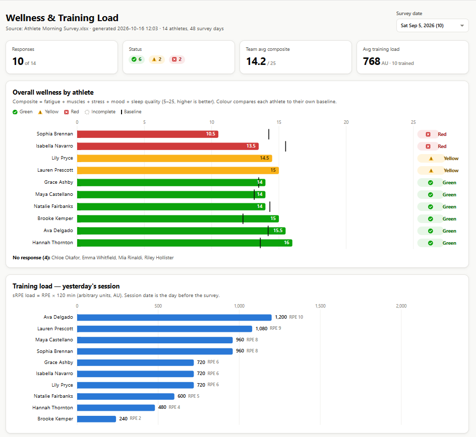
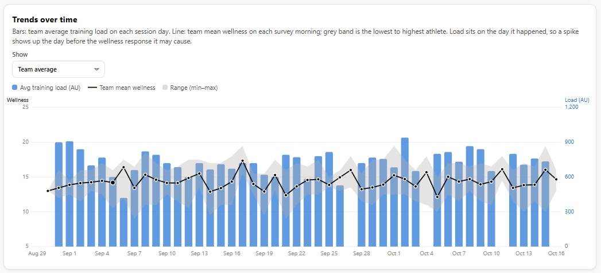
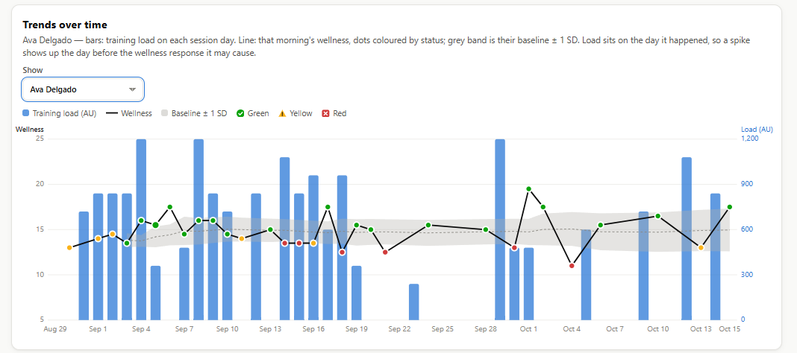
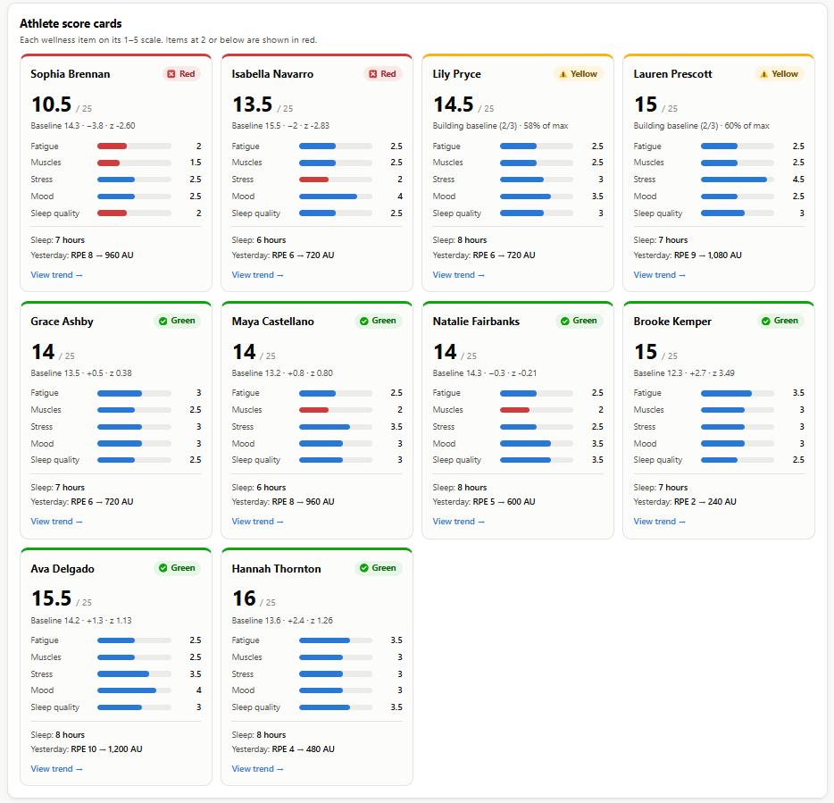

# Wellness & Training Load Report

## Overview
This project automates the creation of an interactive wellness and training load report from a daily athlete morning survey. The goal was to give coaching and sports science staff a quick view of how each athlete is feeling compared to their own normal, alongside the training load from the previous day's session. The report is a single self-contained HTML file that opens in any browser, works on phones and laptops, and lets staff move between survey dates without rerunning anything.

## Problem
Morning survey responses came in as a raw form export with one row per submission, long question-style column headers, duplicate entries, and no context for what a "normal" score looks like for each athlete. Comparing every athlete to one team-wide cutoff also misses athletes who are dropping well below their own baseline while still looking fine on paper. Staff needed a fast way to see who to check in with before practice, without manually sorting through the spreadsheet.

## Data
Athlete morning survey export (Excel or CSV), including:
- Athlete name, survey date, and completion time
- Whether the athlete practiced or played the previous day, and the reason if not
- Session RPE (rating of perceived exertion)
- Wellness items on a 1 to 5 scale: fatigue, muscle soreness, stress, mood, and sleep quality
- Hours of sleep

## Tools
- R
- readxl
- jsonlite
- HTML, CSS, and JavaScript (custom SVG charts, no external charting library)

## Outcome
Created an automated workflow that reads the survey export, matches columns by keyword so small changes to question wording don't break it, cleans names and dates, and keeps only the latest submission when an athlete submits more than once in a day. It then calculates:
- **Wellness composite**: the sum of the five wellness items (5 to 25, higher is better)
- **Individual baseline**: each athlete's own rolling 28-day mean and standard deviation, with a z-score showing how far today's composite is from their normal
- **Status flag**: Green, Yellow, or Red based on the z-score; until an athlete has enough history to build a baseline, status is based on percent of the maximum score instead
- **Training load**: session RPE × session duration (sRPE, in arbitrary units), assigned to the day the session actually happened

The data is embedded directly into the HTML template, producing one report file plus a processed CSV. The report includes:
- Summary cards for response count, Green/Yellow/Red counts, team average wellness, and average training load
- A wellness bar chart by athlete with each athlete's baseline marked and a list of athletes who didn't respond
- A training load bar chart for the previous day's session, including reasons for missed sessions
- A trend chart overlaying training load and wellness over time for the team or any individual athlete
- Individual athlete cards showing each wellness item, with low scores (2 or below) highlighted in red
- A full data table and a plain-language explanation of the method

The script also prints a console summary of the latest day, including a "check in with" list of Red and Yellow athletes.

## Applied Use
- Use the Green/Yellow/Red flags to identify athletes reporting well below their own normal, not just below a team-wide cutoff.
- Check in with Red and Yellow athletes before practice to discuss sleep, soreness, stress, or other factors that may affect readiness.
- Use the trend chart to see whether high training load days are followed by drops in wellness, which can help guide decisions about volume and recovery.
- Individual item scores show *why* an athlete is flagged, such as poor sleep versus high soreness, so the response can match the cause.
- The report can be shared or opened on a phone before practice for fast decision-making about modifications and athlete readiness.

